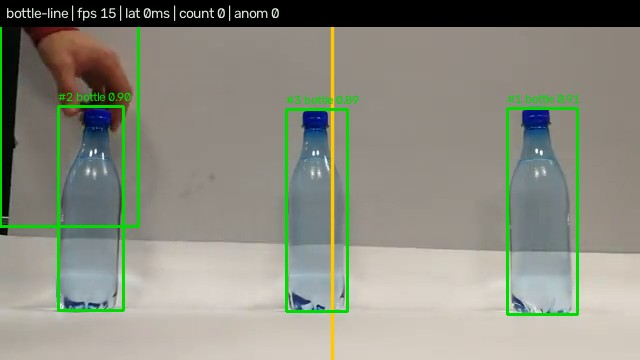
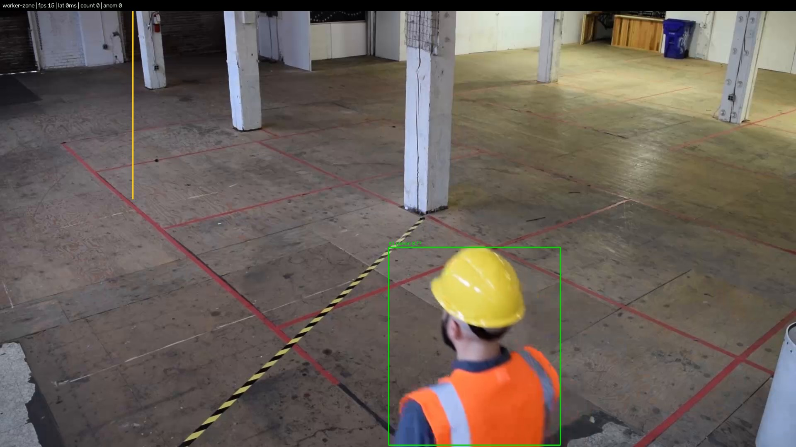
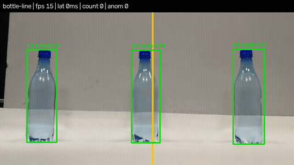
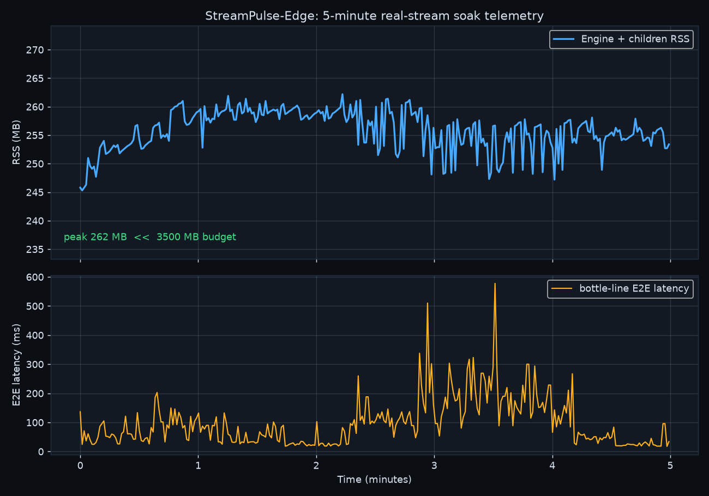

# StreamPulse-Edge

CPU-only, production-grade multi-stream edge video analytics on **Intel Core
i3-1005G1 (2C/4T, no GPU, 8 GB RAM, Pop!_OS Linux)**. Two real industrial video
streams, real INT8 YOLO11n detection, IoU tracking, ROI counting, backpressure,
Prometheus metrics and a live dashboard — with measured RSS flat at ~270 MB.

## Visual proof

| Bottle conveyor (real detections + track IDs + ROI line) | Factory worker zone |
|---|---|
|  |  |

Live 5-second tracking/counting preview (8 FPS, 480 px, <2 MB):



Five-minute real-stream telemetry (RSS and end-to-end latency):



## One-command reproduction

```bash
cd /home/divine/StreamPulse-Edge
python tools/download_assets.py          # CC-BY videos + FP32 ONNX -> /mnt/data
python tools/quantize_yolo_int8.py       # calibrated INT8 ONNX + verification
tools/start_rtsp_sim.sh                  # 2 real RTSP cameras (UDP fallback if no MediaMTX)
python -m streampulse --config config/default.yaml
python tests/soak_test.py                # 5 min, writes Markdown report
```

All downloaded videos and models live under `/mnt/data` (HDD). Peak engine RSS
stays below 3.5 GB.

## Measured results on i3-1005G1

### Production soak — 2 real streams, 5 minutes

Full report: `reports/soak_report_real_2stream_5min.md`

| Metric | Value |
|---|---|
| Verdict | PASS |
| RSS start / end / peak | 245.3 / 255.8 / 262.2 MB |
| RSS leak slope | -87.9 (allocator reclaim; RSS flat after warmup) MB/hour |
| CPU avg / max | 82.8 / 100.0% |
| E2E latency p50 / p95 / p99 | 73.2 / 267.4 / 337.9 ms |
| Dropped frames | 0.1% |
| Objects counted | 19 |
| OOM / crashes | 0 / 0 |

### Backpressure stress — 4 real streams, 2 minutes

Full report: `reports/stress_report_4stream_2min.md`

| Metric | Value |
|---|---|
| Verdict | PASS |
| RSS peak | 318.0 MB |
| CPU avg / max | 88.2 / 100.0% |
| Backpressure skip ratio avg / max | 7.00 / 7 |
| THROTTLED/CRITICAL time | 100% (CRITICAL) |
| E2E latency p99 | 291.0 ms |
| OOM / crashes | 0 / 0 |

With four 640x480 streams the i3 saturates at ~88% CPU. The controller clamps
the skip ratio at 7 (one inference per eight frames) for the whole run, holds
RSS at ~315 MB, and keeps p99 latency at 291 ms. No OOM, no crash, no frame
queue growth. This is the intended failure mode: drop inference work, never
the process.

### FP32 vs INT8 ONNX (single-frame, 416×416, CPU, 2 threads)

| Model | Median latency | Detections (60 val frames) | Mean confidence | Classes seen |
|---|---|---|---|---|
| FP32 `yolo11n_416.onnx` | 26.6 ms | 131 | 0.760 | bottle, person, chair, dining table, sports ball |
| INT8 `yolo11n_416_int8.onnx` | 16.8 ms | 102 | 0.837 | bottle, person, orange, sports ball |
| Speedup | **1.58×** | | | |

Quantization uses `onnxruntime.quantization` static QOperator INT8 calibrated on
60 real frames from both Intel videos. Full-model INT8 corrupted the Detect head
(class scores > 1), so the script automatically excludes the final Detect head
nodes (kept in FP32). This preserves real boxes and yields the speedup above;
`quantize_dynamic` is the final fallback. Raw ONNX output `1x84x3549` is decoded
as `cx, cy, w, h + 80 COCO class scores`, with top-k prefiltering, confidence
thresholding, NMS, and letterbox coordinate unmapping.

## Architecture

```
4 camera threads ──> [fixed 3-slot shared-memory ring, latest-frame-wins] ──> inference process
   (cv2 decode, GIL released)                                                (YOLO11n INT8, IoU tracker,
                                                                             line counting, dwell alarms)
                                                                                    │
                                        FastAPI: /  /metrics  /api/stats  /api/stream/N/mjpeg  /ws/stats
                                                                                    │
                                          monitor thread: CPU/RSS -> backpressure skip value
```

- **Bounded ring buffers** (`src/streampulse/ring_buffer.py`). Each camera owns
  exactly three frame slots in POSIX shared memory. Stale frames are overwritten
  instead of queued, so memory cannot grow with detector lag.
- **GIL isolation.** OpenCV decode releases the GIL in native code; ONNX Runtime
  runs in a separate process, pinned to two intra-op threads. Frames cross via
  shared memory, never pickled.
- **Backpressure** (`src/streampulse/backpressure.py`). EMA-smoothed CPU/RSS
  controller raises a frame-skip ratio (1 of every N+1 frames) under load and
  recovers slowly with hysteresis. RSS soft limit 3.0 GB, hard limit 3.3 GB with
  forced `gc.collect()`, below the 3.5 GB ceiling.
- **Observability.** Prometheus `/metrics` includes per-stream FPS, p95 latency,
  dropped %, counts, CPU/RSS and backpressure state. Dashboard streams MJPEG
  tiles and a WebSocket-fed resource/latency chart.

## Configuration

- `config/default.yaml` — 2 real streams, RTSP paths `/bottle` and `/worker`.
- `config/default_udp.yaml` — same via UDP MPEG-TS (no MediaMTX installed).
- `config/stress_4stream.yaml` / `config/stress_4stream_udp.yaml` — 4 streams
  with tightened backpressure thresholds for the stress test.

ROI lines (normalised): bottle `x=0.85` (right bottle shifts right), worker
`x=0.60` (worker walks across the zone). `tracker_max_age=60` frames holds IDs
through detection gaps so crossings are counted.

## Tests

```bash
python -m pytest -q
python tools/make_visuals.py       # regenerate all assets in assets/
```
